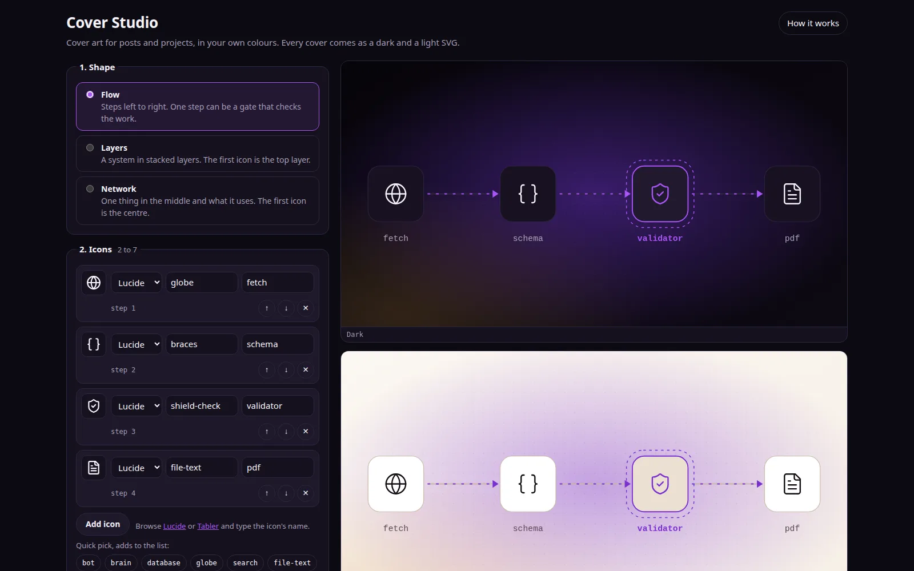

# Cover Studio

Makes cover art for blog posts and projects: a few icons arranged as a
pipeline, a stack of layers or a network, in your own colours. Every cover
comes out twice, dark and light, as small SVG files (about 6 KB each).

It is the web version of the script that draws the covers on
[elkushi.github.io/blog](https://elkushi.github.io/blog/), so it gives the same look.

**Use it online:** https://elkushi.github.io/cover-studio/

## Run it

Open it online at the link above, or download this folder and open
`index.html` in Chrome, Edge or Firefox. That's it: no install, no server,
no build step. It needs the internet only to fetch icons the first time; after
that they are kept in the browser.

To share it with a team, put the folder on any static host (GitHub Pages,
Netlify) as it is.

## Use it

1. **Shape.** Flow for steps in order (one step can be a gate that checks the
   work), Layers for a system in tiers, Network for one thing and what it uses.
2. **Icons.** 2 to 7. Type a name from [Lucide](https://lucide.dev/icons) or
   [Tabler](https://tabler.io/icons), or click one in the quick-pick list.
   Labels are optional; short code-like labels work in every language.
3. **Size.** 1200 × 630 is the size blogs and link previews use. Square,
   portrait, wide and banner presets are there too, or type your own.
4. **Colours.** Pick a colour set, change any colour, or paste a project's CSS
   under "Use a project's colours" to pick up its `--bg`, `--text`,
   `--border`, `--accent` (and similar) variables.
5. **Export.** SVG or PNG (2× size, sharp on phones), dark or light, or copy a
   ready `<picture>` tag that shows the dark cover in dark mode.

"Save settings" writes a small `.cover.json` file. Keep one per project and
open it next time to get the same colours and layout.

## Files

| File | What it does |
|---|---|
| `index.html` | The page |
| `app.js` | The form, the preview and the exports |
| `draw.js` | Turns settings into an SVG. The drawing code. |
| `palettes.js` | Colour sets and the CSS import |
| `style.css` | The app's own look, dark and light |

## Safety and licences

Icons come from Lucide (ISC licence) and Tabler Icons (MIT licence), both free
to use without asking. Each downloaded icon is cleaned before use: only shape
elements and their geometry are kept, so no script or link can ride in with
it. Labels and descriptions are escaped. Nothing you type leaves your browser.

## Licence

MIT. See `LICENSE`.
